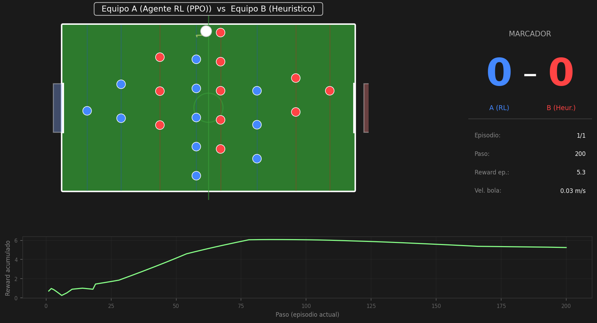

# Futbolín Autónomo — Simulador RL

Simulador de futbolín tipo **Madrid** (estilo español tradicional) diseñado para entrenar agentes de **Reinforcement Learning** y transferirlos a hardware real.

Simula el sistema real: un robot con motores paso a paso contra una persona, visto por una cámara.



---

## Motivación

El futbolín es un entorno de control con características interesantes para RL:
- Dinámica rápida y no lineal (bola, rebotes, rotación de barras)
- Acción continua en dos ejes (posición lineal + ángulo de rotación)
- Recompensas escasas (gol) complementadas con señales densas
- Sim-to-real: el simulador está diseñado para sustituirse por hardware real sin cambiar el agente


> Documentación técnica completa (valores, fuentes, resultados, lecciones y referencias): [`docs/REFERENCIA.md`](docs/REFERENCIA.md).

---

## Estructura del proyecto

```
Modelo/
├── world.py        — Estado (bola, barras, campo), geometría de las figuras y masas
├── hardware.py     — Especificación del sistema real: motores, mecánica, rival humano, cámara
├── physics.py      — Física: contactos 3D con masas reales, bola con giro, rebotes, gol
├── actuators.py    — Motores paso a paso (robot) y manos (rival)
├── vision.py       — Cámara cenital: latencia, ruido, oclusión, filtro α-β
├── observation.py  — Observación realista v3 (actor) + estado privilegiado (crítico)
├── policies.py     — Política actor-crítico asimétrica y exportación del actor
├── reward.py       — Recompensa con shaping de potencial
├── env.py          — Entorno Gymnasium, rivales heurístico / ausente / política
├── optimize_teacher.py — Optimiza el heurístico del robot con CMA-ES (el profesor)
├── dagger.py       — Imitación con DAgger del profesor (el alumno ve solo cámara y firmware)
├── imitation.py    — Funciones de imitación simple (preentrenamiento del actor y el crítico)
├── train.py        — PPO con currículo y self-play
├── benchmark.py    — Partidos de 60 s con intervalo de confianza
├── dashboard.py    — Panel web local para seguir el entrenamiento
├── example.py      — Agente heurístico
├── visualize.py    — Graba un partido y lo reproduce en el navegador (planta y alzado)
└── test_training.py
```

---

## El campo

Campo interior de referencia: **Don Futbolín Madrid**, de
[116 × 70 cm según su ficha](https://www.donfutbolin.com/product/futbolin-modelo-don-futbolin).
El campo es plano.

| Parámetro | Valor |
|---|---|
| Largo × ancho | 116 × 70 cm |
| Bola | 35 mm, ~24 g (estimado) |
| Portería | 20 cm (estimado) |
| Barras | 8 (4 por equipo) |

### Distribución de barras

```
  [Portería A]                                          [Portería B]
  x=-0.58                                               x=+0.58

  GK-A    DEF-A   ATK-B   MID-A   MID-B   ATK-A   DEF-B   GK-B
  (1j)    (2j)    (3j)    (5j)    (5j)    (3j)    (2j)    (1j)
  -0.50  -0.36   -0.20   -0.05   +0.05   +0.20   +0.36   +0.50
```

Cada barra tiene **dos grados de libertad**: desplazamiento lateral ±7 cm y giro ±180°.

### Figuras madrileñas con pie de taco

Cada figura es una unión de rectángulos redondeados en la vista lateral (x‑z)
que gira con la barra: cabeza y torso, pierna y un **taco** macizo de suela
plana. En Y mide 30 mm.

| Medida | Valor | Fuente |
|---|---|---|
| Centro de la barra → pies | 71 mm | fichas de jugadores madrileños ([Billares Balsalobre](https://www.billaresbalsalobre.com/tienda/futbolin/jugador-futbolin/billaresbalsalobre-jugador-futbolin-madrileno-madera-natural/), [Billares y Juegos](https://www.billaresyjuegos.com/jugadores-munecos-futbolines-jugador-muneco-futbolin-madera-pasador-rojiblanco-estandar-medidas-p-318.html)) |
| Centro de la barra → cabeza | 48 mm | ídem |
| Anchura máxima | 30 mm | ídem |
| Taco: largo (X) × alto | 30 × 20 mm | estimado, medir |
| Holgura suela‑campo | 3 mm (barra a 74 mm) | estimado |
| Masa de una figura | 40 g | estimado, pesar |

Consecuencias físicas: con el jugador levantado más de ~71° la bola pasa por
debajo, y con la barra cerca de 180° la **cabeza** baja hasta 26 mm del campo y
toca la bola. Por eso el golpe se arma a unos −110°, no a −180°.

---

## Qué simula (sistema real: robot contra persona, visto por cámara)

### Robot — `actuators.py`, `hardware.py`

Cada barra del robot tiene dos motores paso a paso (**NEMA17 17HS4401** con
driver TMC2209 a **12 V**, como en `Hardware/MCU-RT`): uno gira la barra en directo
y otro la desplaza con una correa GT2 (polea de 30 dientes, **supuesta**: hay que
confirmarla). El motor es el mismo en los dos ejes y el simulador limita su
velocidad de crucero a 47 rad/s.

- **Motor**: par como muelle sinusoidal hacia la posición comandada,
  `T = −T(ω)·sin(50·(q − q_cmd)) − c·(ω − ω_cmd)`, con la inercia real de cada barra
  (varilla + figuras). La curva par‑velocidad sale del modelo eléctrico del motor
  (1,7 A, 1,5 Ω, 2,8 mH, 40 N·cm; no hay curva medida): **0,28 N·m parado y
  0,18 N·m a 47 rad/s** con 12 V (con 24 V serían 0,28 N·m a esa velocidad).
- **Rango de giro**: de **−90° a +90°** con 0 en vertical. El **portero** gira solo de
  **−10° a +90°** (tope mecánico). Levantar es siempre a −90°; el ángulo positivo
  se usa para golpear. En el equipo B los ángulos están girados 180°.
- **Firmware**: perfil trapezoidal con la aceleración limitada al 50 % del par
  disponible a cada velocidad. La orden llega con 10 ms de latencia.
- **Pérdida de pasos**: si una carga (golpe de la bola, taco que pisa la bola, motor
  más débil de lo previsto) separa el rotor más de 2 pasos, el motor salta. **El giro va
  en lazo cerrado** (encoder, por defecto): el MCU corrige el desfase en cada ciclo. El
  **eje lateral va en lazo abierto**. Alternativa sin encoder: `RobotSpec(encoders=False,
  home_switch=True)`, con un final de carrera a −90° que recupera la referencia cada vez
  que se levanta el jugador. Sin ninguna de las dos, una barra quedaba desfasada más de
  5° el 66 % del tiempo.

Capacidades con los valores por defecto (`python hardware.py`):

| Barra | Figuras | Aceleración de giro | Vel. de giro | Vel. de la punta | Vel. lateral |
|---|---|---|---|---|---|
| GK | 1 | ~1.100 rad/s² | 47 rad/s | 3,3 m/s | 0,45 m/s |
| DEF | 2 | ~670 rad/s² | 47 rad/s | 3,3 m/s | 0,45 m/s |
| MID | 5 | ~300 rad/s² | 47 rad/s | 3,3 m/s | 0,45 m/s |
| ATK | 3 | ~480 rad/s² | 47 rad/s | 3,3 m/s | 0,45 m/s |

Un golpe armado saca la bola a unos 2,5 m/s. Con solo 90° de carrerilla (10° el
portero), el golpe está limitado por la **aceleración**, no por el tope de velocidad.

### Rival humano

Perfil de mano y muñeca (1,5 m/s lateral, 45 rad/s de giro) escalado por su
nivel, con la inercia de la mano añadida a la barra. El heurístico decide con un
retardo de 60–200 ms según el nivel, y el nivel se sortea en cada partida.

### Física — `physics.py`

| Fenómeno | Modelo |
|---|---|
| Integración | 6 subpasos de física y ~18 del motor por paso de control de 20 ms |
| Contacto bola‑figura | punto más cercano de cabeza, pierna o taco (3D); impulso con restitución 0,70 y fricción de Coulomb 0,30 |
| Masas | la bola y la barra intercambian impulso: una barra ligera retrocede al recibir un tiro y golpea con menos fuerza |
| Bola con giro | tras un golpe desliza (μ = 0,25) hasta rodar y pierde ~2/7 de su velocidad; en las bandas el rozamiento frena parte del giro |
| Rodadura | resistencia constante 0,15 m/s² + viscosa 0,05/s |
| Pisar la bola | la suela presiona la bola desde arriba: la frena y el motor se bloquea |
| Bola atrapada | entre dos figuras: se detiene y los motores se bloquean |
| Bandas, fondos, gol | restitución 0,65; gol si la bola cabe entre los postes al cruzar la línea |
| Rampas de esquina | junto a los fondos, fuera de la boca de gol, la bola vuelve hacia el centro |
| Aleatorización | por partida: rozamientos, restituciones, masa de la bola, par, inercia y rozamiento de los motores, latencia de la cámara |

### Cámara — `vision.py`

Por defecto una **Logitech Brio** en 720p a 90 fps. Simula:
- Latencia: 70 ms, con una variación del ×0,8–1,3 en cada partida. Es una
  estimación; hay que medirla.
- Ruido de 1,5 mm, más el emborronado de la bola rápida (4 ms de exposición).
- Fallos de detección.
- **Oclusión**: desde arriba, la bola no se ve bajo una figura.
- Velocidad estimada con un filtro α‑β (no la real).

Las barras rivales y las propias también se miden con la cámara.

### Observación — `observation.py`

| Parte | Dims | Contenido |
|---|---|---|
| Actor | 186 = 62 × 3 fotogramas | bola según la cámara (+ visible, tiempo sin verla), barras propias según el firmware y según la cámara, barras rivales según la cámara, bola relativa a cada barra, acción anterior |
| Crítico (solo entrenamiento) | +54 | bola real con su giro, las 8 barras reales, error de la estimación propia |

La política del robot **solo usa la parte del actor**. `obs_version=2` (44
dims) y `1` (36) siguen disponibles con estado perfecto para los modelos antiguos.

### Recompensa — `reward.py`

| Componente | Valor |
|---|---|
| Gol marcado / recibido | +10 / −10 |
| Tiro a puerta propio / del rival | +0,5 / −0,25 |
| Shaping de potencial: posición y velocidad de la bola hacia la portería rival | pesos 1,0 y 0,5 |
| Shaping de potencial: proximidad jugador‑bola (fases 0 y 1) | 0,5 / 0,2 |
| Cambio brusco de acción | −0,001 × \|Δacción\| |

El shaping es de **potencial** (Ng et al. 1999): no cambia la política óptima y
el agente no puede "farmearlo".

### Entorno — `env.py`

```python
env = FoosballEnv(
    controlled_team='A',        # el equipo del robot (la observación se gira para el B)
    opponent='heuristic',       # 'heuristic' | 'absent' | None | PolicyOpponent(modelo)
    opponent_skill=(0.4, 1.0),  # nivel fijo o rango sorteado en cada partida
    noise=True,                 # ruido + aleatorización
    realistic=True,             # False: actuadores ideales y física simplificada
    spec=SimSpec(),             # hardware.py: motores, mecánica, rival y cámara
    continue_after_goal=True,   # el partido sigue tras un gol (saca el portero que lo recibió)
)
```

**Formato de partido**: como en la mesa real, el juego continúa tras cada gol y
**saca el portero del equipo que lo ha recibido**: la bola queda parada a 45–60 mm
delante de él. Un episodio es un partido de `max_steps` pasos (1.500 = 30 s en
entrenamiento, 3.000 = 60 s en evaluación). El shaping de potencial trata cada gol
como el final de un tramo (Φ = 0) para no premiar el salto de la bola al saque. El
formato antiguo (el episodio termina en el primer gol) sigue disponible con
`continue_after_goal=False`.

Acción (8 dims, [−1, 1]): `[lin, ang] × (GK, DEF, MID, ATK)` del robot, como
posiciones objetivo. `ang > 0` lleva el pie hacia delante.

### Para conectar hardware real

1. Medir y poner en `hardware.py` el par del motor, la polea, las masas de las
   figuras y la latencia de la cámara, y volver a entrenar.
2. En el PC: detectar la bola y las barras con la cámara y construir la parte
   del actor de la observación como en `observation.py`.
3. Ejecutar el actor con `policies.actor_weights()` y `actor_forward()`, que
   solo necesitan NumPy (~115 k pesos, < 1 ms). También cabe en el STM32 de la
   NUCLEO‑H753ZI (2 MB de flash), pero **no puede leer la Logitech Brio**: la cámara
   necesita un PC o una Raspberry Pi.
4. Enviar a la placa las 8 posiciones objetivo a 50 Hz. El firmware genera el
   perfil trapezoidal limitado por par.

---

## Entrenamiento

### Algoritmo

**PPO** con un **actor‑crítico asimétrico**:
- **Actor**: MLP 186 → 256 → 256 → 8. Solo ve lo que tendrá el robot.
- **Crítico**: MLP 240 → 256 → 256 → 1. Ve además el estado real, y solo existe
  durante el entrenamiento.

Con información ruidosa y tardía, un crítico que conoce el estado real estima
mucho mejor el valor de cada situación. Es la técnica habitual para transferir
de simulación a robot (Pinto et al., 2018). La memoria corta va en los 3
fotogramas apilados, que sirven para la fase del golpe, las aceleraciones y la
latencia.

**Profesor optimizado** (`optimize_teacher.py`): el heurístico tiene 14 parámetros
(`env.HeuristicParams`: ángulos de armado y de golpe, ventanas de distancia, pose
levantada, desplazamiento lateral...). CMA‑ES los optimiza jugando partidos de
30 s en el simulador contra rivales de nivel 0,4, 0,7 y 1,0, con las mismas
semillas para todos los candidatos de una generación (reduce mucho el ruido), y
valida el resultado con partidos nuevos y su intervalo de confianza.

**Imitación con DAgger** (`dagger.py`): el profesor decide con el estado real y sin
retardo; el alumno solo ve cámara y firmware. En cada ronda el alumno juega
(mezclado con el profesor con probabilidad β = 1, 0,5, 0,25, 0, 0), el profesor
etiqueta lo que haría en esos mismos estados y se reentrena con todo lo
acumulado. Así el alumno aprende a recuperarse de sus propios errores. Sin este
arranque, PPO desde cero no descubría la secuencia armar‑golpear.

| Ajuste | Valor |
|---|---|
| Entornos | 8 (`SubprocVecEnv`) |
| Pasos por actualización | 1024 × 8 |
| Lote / épocas | 512 / 10 |
| γ / λ | 0,99 / 0,95 |
| Tasa de aprendizaje | 1e‑4 → 3e‑5 con arranque por imitación (3e‑4 sin él) |
| Exploración | gaussiana, std inicial 0,3 tras la imitación |
| Normalización | solo de la recompensa |

`best/best_model.zip` se elige por diferencia de goles contra el heurístico de
nivel 0,7, siempre con las mismas semillas.

### Currículo

Los partidos duran 30 s y continúan tras cada gol. Si se parte de un alumno
DAgger (`--init-model`) se omite la fase 0, porque ya sabe jugar.

| Fase | Rival | Pasos |
|---|---|---|
| 0 (solo sin `--init-model`) | ausente (jugadores levantados), sin ruido | 10 % |
| 1 | heurístico, nivel sorteado 0,2–0,6 | 15–20 % |
| 2 | heurístico, nivel 0,4–1,0 | 40–85 % |
| 3 (`--self-play`) | 50 % heurístico 0,5–1,0, 50 % copias congeladas de la política | 35–45 % |

### Uso

Ejecuta estos comandos desde el directorio `Modelo/`:

```bash
pip install -r requirements.txt

python hardware.py                                   # capacidades del robot con la especificación actual

# 1. Profesor: optimizar el heurístico (~40 min)
python optimize_teacher.py --minutes 40
# 2. Alumno: imitación con DAgger (el alumno solo ve cámara y firmware)
python dagger.py --teacher models/teacher/heuristic_optimized.json --out models/dagger/student
# 3. PPO partiendo del alumno
python train.py --timesteps 2000000 --curriculum --self-play \
    --init-model models/dagger/student --save-dir models/ppo_v5 --log-dir logs/ppo_v5

# Evaluar: partidos de 60 s con intervalo de confianza al 95 %
python benchmark.py --matches 100 --skill 0.7 models/dagger/student models/ppo_v5/best/best_model
python visualize.py --teacher                       # graba un partido y lo abre en el navegador
python visualize.py --model models/dagger/student --seconds 60 --seed 3
python -m unittest -v test_training
```

Los modelos anteriores (v1, v2) se pueden cargar y evaluar en el simulador
realista con su observación perfecta. Se entrenaron con otra física, así que sus
resultados no son comparables.

### Seguir el entrenamiento

Desde el directorio `Modelo/`, el panel lee los eventos de TensorBoard del
entrenamiento indicado:

```bash
python dashboard.py --log-dir logs/ppo_v5 --total 2000000
```

### Entrenar variantes en GitHub Actions

`.github/workflows/train.yml` (solo se lanza a mano) entrena en paralelo 5
variantes —3 semillas con red de 256 neuronas y redes de 128 y 512— con DAgger y
PPO, y publica los resultados como artefactos **sin escribir nada en el
repositorio**. Necesita `models/teacher/heuristic_optimized.json` en el repositorio.
Cada variante usa 4 vCPU y tarda ~1,5–2 h con 2M pasos.

El entrenamiento también se puede seguir con TensorBoard:

```bash
tensorboard --logdir logs/ppo_v5
```

---

## Uso rápido

```python
from env import FoosballEnv

# Partido de 30 s contra un rival heurístico: sigue tras cada gol (saca el portero que lo recibe)
env = FoosballEnv(max_steps=1500, opponent_skill=0.7)
obs, _ = env.reset(seed=0)
for _ in range(1500):
    obs, reward, terminated, truncated, info = env.step(env.action_space.sample())
    if terminated or truncated:
        break
print(info["score"], obs.shape)       # observación v3: 240 dimensiones (el actor usa las 186 primeras)
```

```python
# Heurístico de referencia (el profesor) jugando
from env import FoosballEnv, RoleParams
from example import HeuristicAgent

env = FoosballEnv(max_steps=1500)
agent = HeuristicAgent(env, reaction_delay=0.0, params=RoleParams.load("models/teacher/base_90.json"))
obs, _ = env.reset(seed=1)
for _ in range(1500):
    obs, *_ = env.step(agent.predict())
```

```python
# Cargar una red entrenada (alumno DAgger o PPO)
from stable_baselines3 import PPO
from env import FoosballEnv

model = PPO.load("models/dagger/student")
env = FoosballEnv()
obs, _ = env.reset(seed=1)
for _ in range(1500):
    action, _ = model.predict(obs, deterministic=True)
    obs, r, terminated, truncated, info = env.step(action)
```

Para ver un partido en el navegador: `python visualize.py --teacher models/teacher/base_90.json`.

---

## Dependencias

```
numpy>=2.0
stable-baselines3[extra]>=2.0
gymnasium>=0.29
torch>=2.0
matplotlib>=3.7
cma>=3.3
```

```bash
pip install -r requirements.txt
```

> **Nota:** Se requiere `numpy>=2.0` porque los modelos entrenados se serializan con esa versión. Usar numpy 1.x provocará error al cargar el modelo.

---

## Alcance actual

La cámara, los actuadores y la mecánica están modelados en el simulador, pero
siguen siendo aproximaciones y no hay una conexión de control con la placa. Para
la transferencia a hardware hay que medir y validar esos parámetros, implementar
el firmware y conectar la percepción y el actor al sistema real.

Pendiente de medir, por orden de impacto: latencia real de la Brio (se supone 70 ms),
masa de una figura y del carro (40 g y 0,45 kg estimados), polea y correa del eje lateral,
corriente del driver (1,2 A RMS supuestos), largo y alto del taco. **Los modelos
entrenados hasta ahora usan esas suposiciones y habrá que repetirlos** cuando se midan.

El estado de los resultados, las lecciones aprendidas y el trabajo futuro (por ejemplo,
un profesor por refuerzo) están en [`docs/REFERENCIA.md`](docs/REFERENCIA.md).

---

## Licencia

Proyecto de investigación y desarrollo. Uso libre para fines educativos y de investigación.
